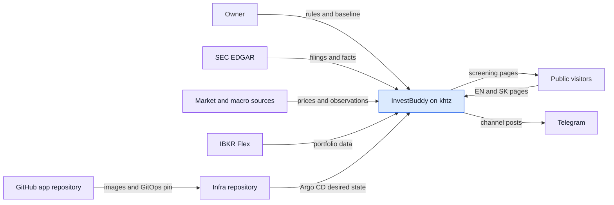
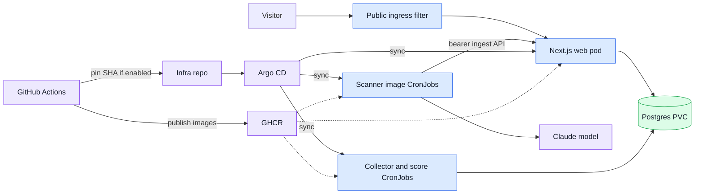
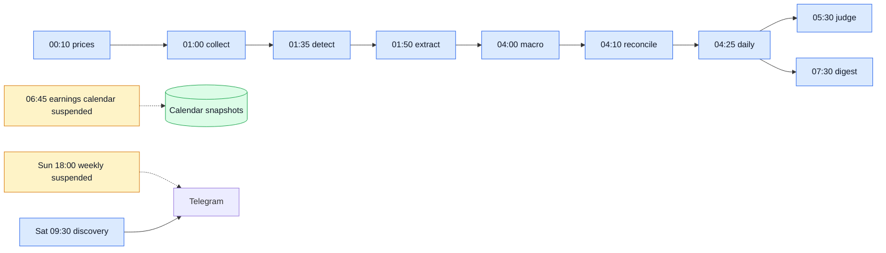
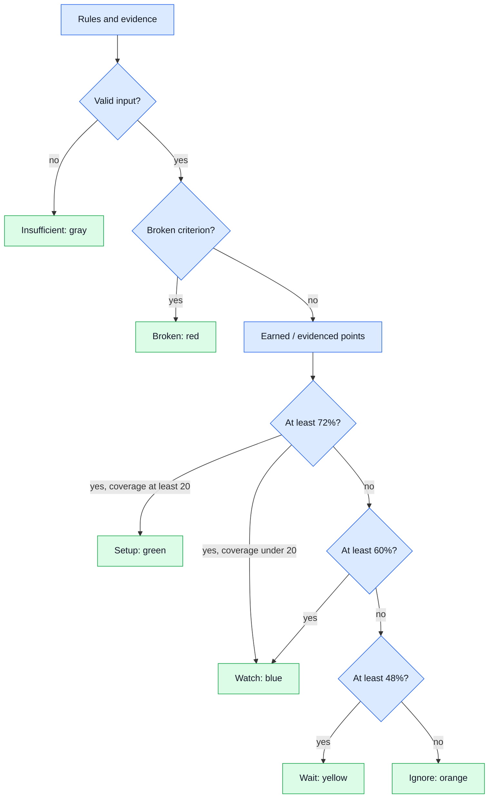
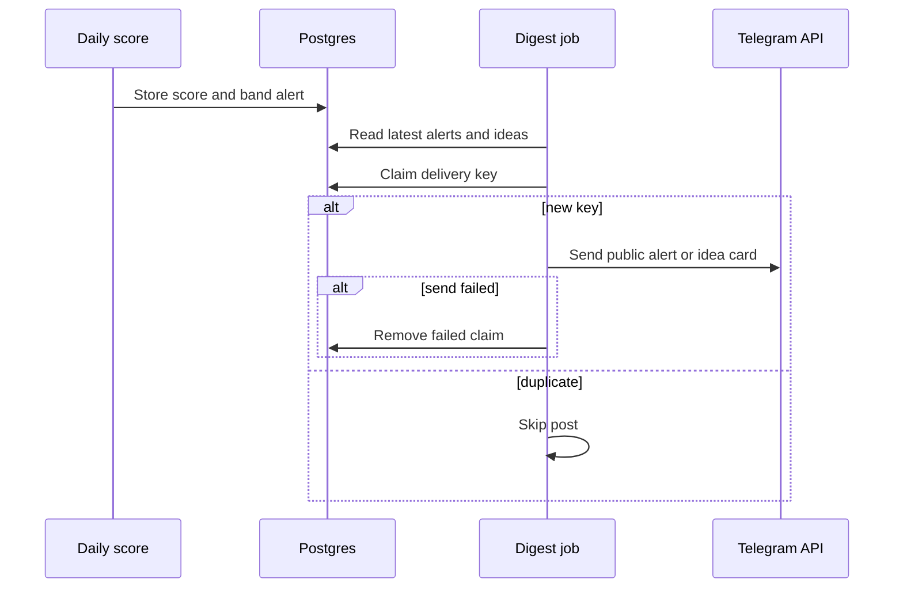
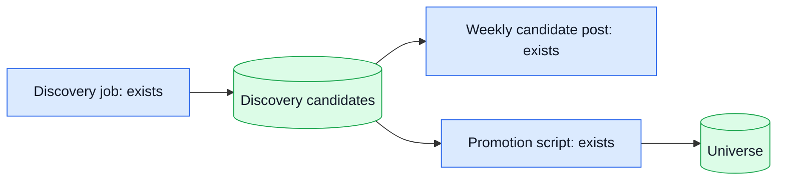
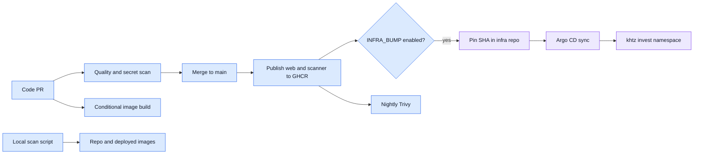
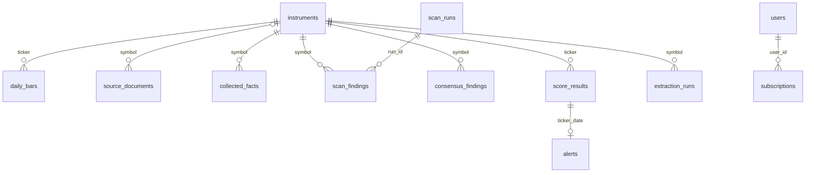

# InvestBuddy architecture

This is the repository view of the system on 2026-10-11. Solid arrows show implemented paths; dashed arrows show planned work or a manual handoff. CronJob state below comes from the GitOps mirror in `deploy/gitops/gitops/apps/invest-buddy/base/`, not a live cluster query. All local schedules use `Europe/Bratislava`; the portfolio job is explicitly UTC. Public output is informational screening under ADR-001 (`docs/wording-gate.md`).

**Legend:** blue = application or job, green = stored data, violet = external service or repository, amber = planned or conditional path. A suspended CronJob has a manifest but does not run on its schedule.

## 1. System context

The owner maintains the rule set and private portfolio baseline. Visitors read the public web; a single Telegram channel receives screening messages. The app collects market and company evidence from external sources, while GitHub and the infra repository carry code and deployment configuration to khtz. See `src/jobs/collect.ts`, `src/jobs/prices.ts`, `src/jobs/portfolio.ts`, `src/notify/telegram.ts`, `deploy/gitops/argocd/apps/web/invest-buddy.yaml` and `.github/workflows/build.yml`.

## 2. Containers and deployment

The Next.js web Deployment serves pages and authenticated ingest routes and runs migrations in an init container. The ordinary job image reads and writes Postgres; the scanner image calls the web ingest API with a bearer token and has no database credential. Argo CD follows the infra repository, whose image tags are pinned by the main build when `INFRA_BUMP=true`. The public ingress rewrites `/api/ingest` to a disabled path (`deploy/gitops/gitops/apps/invest-buddy/base/{web,postgres,public-ingress-filter,extract-judge-cronjobs}.yaml`, `.github/workflows/build.yml`).

## 3. Scheduled run

These are CronJob start times, not completion guarantees. Tuesday through Saturday jobs process the prior market day. Collect also runs on Monday at 01:00 and only stores documents, so weekend press releases are saved before the RSS feeds roll over; Tuesday's detect gates them. Detect, extract and judge do not run on Monday: extract reads one pending gate per run (oldest first), so a Monday gate would delay Tuesday's, and a Monday extract would be judged against Friday's scores. Detect gates extraction, and the judge also uses a change gate; both scanner jobs use the ingest API. The suspended earnings calendar writes snapshots but has no reader in reconcile or daily scoring yet. The diagram covers the requested path, while the table gives the other relevant schedules. Sources are the `*cronjob*.yaml` files and `cronjobs.yaml` in `deploy/gitops/gitops/apps/invest-buddy/base/`, plus `src/jobs/cronjob-order.test.ts`.

| Job | Manifest schedule | State |
| --- | --- | --- |
| prices, watch, collect, detect, extract | Tue–Sat 00:10, 00:45, 01:00, 01:35, 01:50; collect also Mon 01:00 | active |
| GDELT collect | Tue–Sat 01:05 | suspended |
| Retention | daily 03:00 | on since 2026-10-19 |
| macro, reconcile, daily, judge | Tue–Sat 04:00, 04:10, 04:25, 05:30 | active |
| portfolio | Tue–Sat 06:00 **UTC** | active |
| earnings calendar, digest, holder events | daily 06:45; Tue–Sat 07:30, 07:45 | calendar and holder events suspended; digest active |
| Alpha Vantage collect, discovery, review calendar | Sat 08:00, 09:30, 11:00 | active |
| weekly, master refresh | Sun 18:00, 05:00 | suspended |
| 13F quarter jobs | Nov 20 08:00; Feb 16 08:00 | suspended |
| backup | daily 02:30 | suspended |

## 4. Evidence to output

Collectors store bounded source text, facts, bars and provenance. The extractor reads stored bundles; ingest records agent findings, and reconcile verifies quotes against stored documents and combines agent and deterministic findings. Daily scoring uses evidenced points and stores scores and alerts. The judge takes deterministic signals and reconciled inputs, then writes idea wording through the ingest API. Pages and Telegram consume stored results (`src/jobs/{collect,detect,reconcile,daily,digest}.ts`, `src/engine/{score,signals}.ts`, `scanner/run-{extract,judge}.mjs`, `migrations/003_scan_findings.sql`, `migrations/007_source_documents.sql`).

```mermaid
flowchart LR
  sources[SEC and other sources] --> collectors[Collectors]
  collectors --> docs[(Documents and facts)]
  collectors --> bars[(Daily bars)]
  docs --> bundle[Stored bundle]
  bundle --> extract[Extractor]
  extract --> verify[Quote verification]
  verify --> findings[(Scan findings)]
  docs --> reconcile[Reconcile]
  findings --> reconcile
  reconcile --> consensus[(Consensus findings)]
  consensus --> score[Relative scoring]
  bars --> score
  score --> scores[(Scores and alerts)]
  consensus --> signals[Deterministic signals]
  scores --> signals
  signals --> judge[Judge wording]
  judge --> ideas[(Trade ideas)]
  scores --> web[Web pages]
  ideas --> web
  scores --> telegram[Telegram]
  ideas --> telegram
  classDef app fill:#dbeafe,stroke:#2563eb,color:#111827
  classDef data fill:#dcfce7,stroke:#16a34a,color:#111827
  classDef ext fill:#ede9fe,stroke:#7c3aed,color:#111827
  class collectors,bundle,extract,verify,reconcile,score,signals,judge,web app
  class docs,bars,findings,consensus,scores,ideas data
  class sources,telegram ext
```

## 5. Status model

The scorer has six states. A rejected criterion gives Broken; invalid input gives Insufficient. Otherwise it compares earned points with the evidenced maximum: Setup starts at 72%, Watch at 60%, Wait at 48%, and the rest is Ignore. Fewer than 20 of 25 evidenced points caps Setup at Watch. A missing or planned field is “no data”; a known unmet rule has zero earned points but still counts toward coverage. Confirmation chips for insider buying, EPS, guidance, catalyst and volume explain evidence without changing the band (`src/engine/{relative,score,status}.ts`, `docs/roadmap/lane-status.md`).

On a fully evidenced ticker, the thresholds correspond to 18, 15 and 12 of 25 points. `ADVICE_OUTPUT` changes the green label from “Conditions met” to “Buy zone” where allowed; it does not change the score. The web uses `statusView`, while Telegram formats the stored state and points separately with matching band labels (`src/engine/status.ts`, `src/notify/format.ts`, `src/config/flags.ts`).

## 6. Telegram delivery

Digest reads same-day alerts and replaces a short band-change alert with a stored idea card when one exists. Weekly summary has its own suspended CronJob; discovery posts weekly candidates. Each post claims a key in `notification_deliveries` before sending, skips duplicates, and removes a failed claim for retry. Public card mode hides personal amounts and action words; owner card mode is for a private channel and includes them. `ADVICE_OUTPUT=off` further limits public card text (`src/jobs/{digest,weekly,discovery}.ts`, `src/notify/{format,weekly,discovery,telegram}.ts`, `docs/alerts-telegram.md`, `migrations/044_notification_deliveries.sql`).

## 7. Discovery and research

Current discovery ranks candidates using stored and fetched evidence and posts a weekly candidate list. Promotion into the universe is a separate script (`src/jobs/discovery.ts`, `src/notify/discovery.ts`, `scripts/discovery-promote.ts`). The RS research engine (web research model, verifier, pipeline, research cards) was removed on 2026-10-21 by owner decision: EODHD supplies the inputs and AI only judges. Stored `research_*` rows are still read by the judge input, reconcile, detect and the catalyst calendar.

## 8. CI, images and GitOps

Code PRs run quality and secret checks; image-input PRs also build both images. A docs-only change under `docs/*` or `docs/roadmap/**` skips Build, while `docs/design` remains checked. Main publishes SHA-tagged and latest web/scanner images after checks; the optional infra bump pins the SHA, then Argo syncs. Security scans run nightly at 03:15 UTC against published images. `scripts/security-scan.sh` runs local Trivy checks on the repository and, by default, deployed image tags (`.github/workflows/{build,security}.yml`, `docs/ci.md`, `deploy/gitops/argocd/apps/web/invest-buddy.yaml`).

## 9. Web page map

Locale routes are under `/en` and `/sk`. The default public experience includes the home, dashboard, company, scanner, methodology, portfolio, track record, insiders and legal pages; `INSIDERS_PAGE` defaults on. `ADVICE_OUTPUT` gates sizing; it and `IDEAS_PAGE` together gate the ideas route, while `OWNER_VIEW` gates owner allocation; all three default off. The owner route is flag gated and excluded from indexing, but the flag alone is not user authentication. `ADVICE_OUTPUT` also gates advice-like wording and idea detail. The scanner page is a public read view; scanner CronJobs are separate workers. Ingest routes require a bearer token and the public ingress filter blocks their external path (`src/app/[locale]/**/page.tsx`, `src/config/flags.ts`, `src/app/api/ingest/**/route.ts`, `deploy/gitops/gitops/apps/invest-buddy/base/public-ingress-filter.yaml`).

```mermaid
flowchart TD
  root["/en or /sk"] --> home[Home]
  root --> dashboard[Dashboard]
  root --> company[Company /company/ticker]
  root --> scanner[Scanner]
  root --> portfolio[Portfolio]
  root --> insiders[Insiders]
  root --> record[Track record]
  root --> method[Methodology]
  root -.-> sizing[Sizing: ADVICE_OUTPUT]
  root --> legal[Terms and privacy]
  root -.-> ideas[Ideas: IDEAS_PAGE and ADVICE_OUTPUT]
  root -.-> owner[Owner allocation: OWNER_VIEW]
  private[Bearer ingest API] --> db[(Postgres)]
  classDef app fill:#dbeafe,stroke:#2563eb,color:#111827
  classDef data fill:#dcfce7,stroke:#16a34a,color:#111827
  classDef planned fill:#fef3c7,stroke:#d97706,color:#111827
  class root,home,dashboard,company,scanner,portfolio,insiders,record,method,legal,private app
  class sizing,ideas,owner planned
  class db data
```

## 10. Database map

`instruments` anchors ticker keyed market, evidence and scoring tables. Discovery candidates may precede universe membership and have no instrument foreign key. `scan_runs` owns agent findings; reconciliation produces field consensus; score results own the alert for a date. Judge runs and trade ideas keep their own history. The diagram shows important declared foreign keys, not every table or every application-level lookup (`migrations/{001_initial,003_scan_findings,004_consensus,007_source_documents,009_extraction_runs,010_trade_ideas,017_discovery,044_notification_deliveries}.sql`).

Other tables group by purpose: `data_sources`, `raw_snapshots`, `collector_runs`, `price_ingest_runs`, `fundamentals_pit` and `earnings_calendar_snapshots` track source history; `reconcile_runs` and `consensus_findings_history` track verification; `score_input_snapshots`, `record_signals` and `record_snapshots` preserve scoring history; `judge_runs`, `trade_ideas`, `portfolio_baseline`, `portfolio_snapshots` and `portfolio_nav_history` hold ideas and portfolio data; `notification_deliveries` prevents repeat posts. `scheduled_gates`, `ai_budget_calls` and `ai_quota_samples` record job gates and cost. See `migrations/` for the full schema.

## Where to look

| Question | Code or manifest |
| --- | --- |
| Cron schedules and suspension | `deploy/gitops/gitops/apps/invest-buddy/base/*cronjob*.yaml`, `cronjobs.yaml` |
| Collection and candidate discovery | `src/jobs/collect.ts`, `src/jobs/discovery.ts`, `src/collectors/` |
| Extraction and judge runners | `scanner/run-extract.mjs`, `scanner/run-judge.mjs`, `src/app/api/ingest/` |
| Reconciliation and scoring | `src/jobs/reconcile.ts`, `src/jobs/daily.ts`, `src/engine/` |
| Telegram | `src/jobs/digest.ts`, `src/jobs/weekly.ts`, `src/notify/` |
| Pages, flags and public ingress | `src/app/[locale]/`, `src/config/flags.ts`, `deploy/gitops/gitops/apps/invest-buddy/base/public-ingress-filter.yaml` |
| Schema, CI and deployment | `migrations/`, `.github/workflows/`, `deploy/gitops/` |

## What is not built yet

The [task board](roadmap/board.md) is authoritative for status. Account, billing and paid-tier delivery remain deferred. Several data jobs have manifests but are suspended, as shown above; their presence is not proof of live operation. The board also tracks the remaining web and data work.
