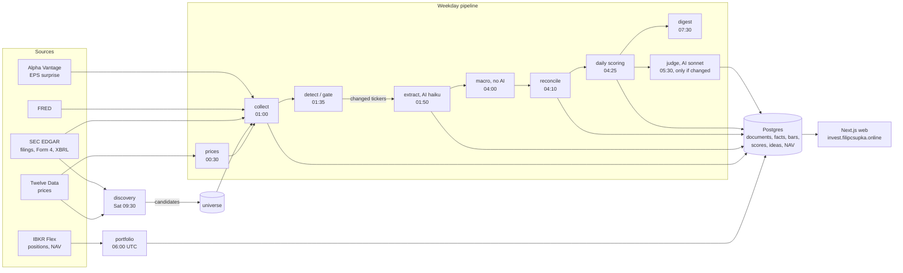
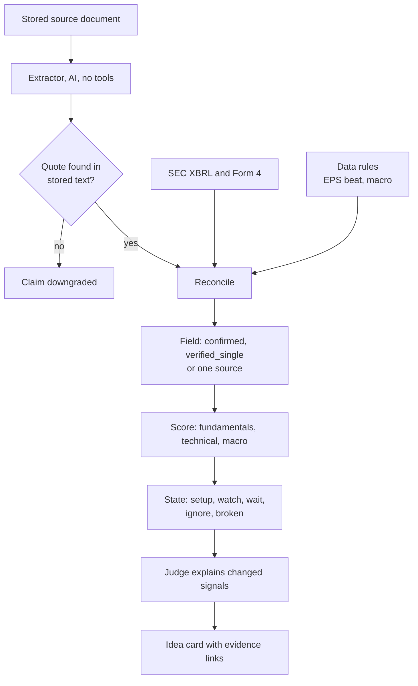
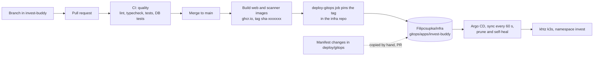
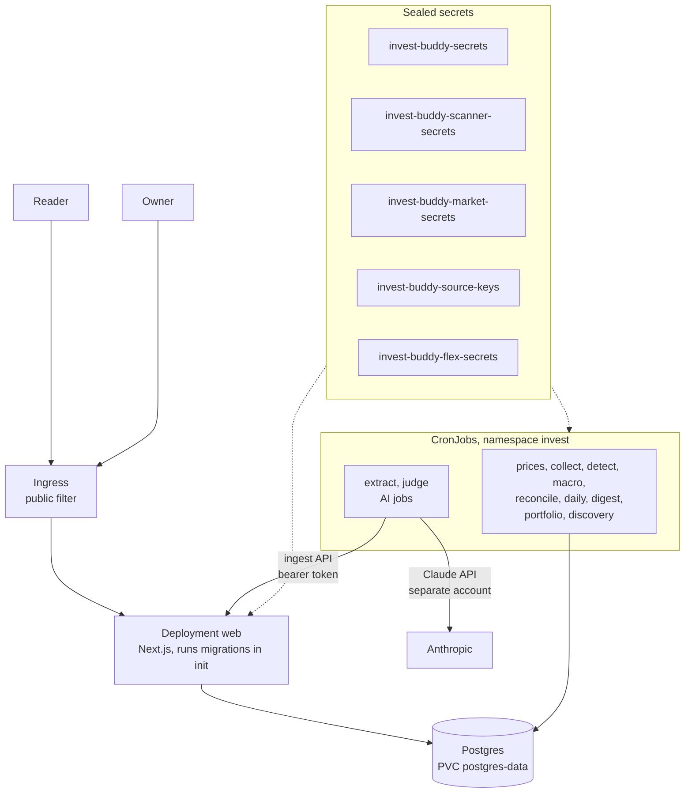
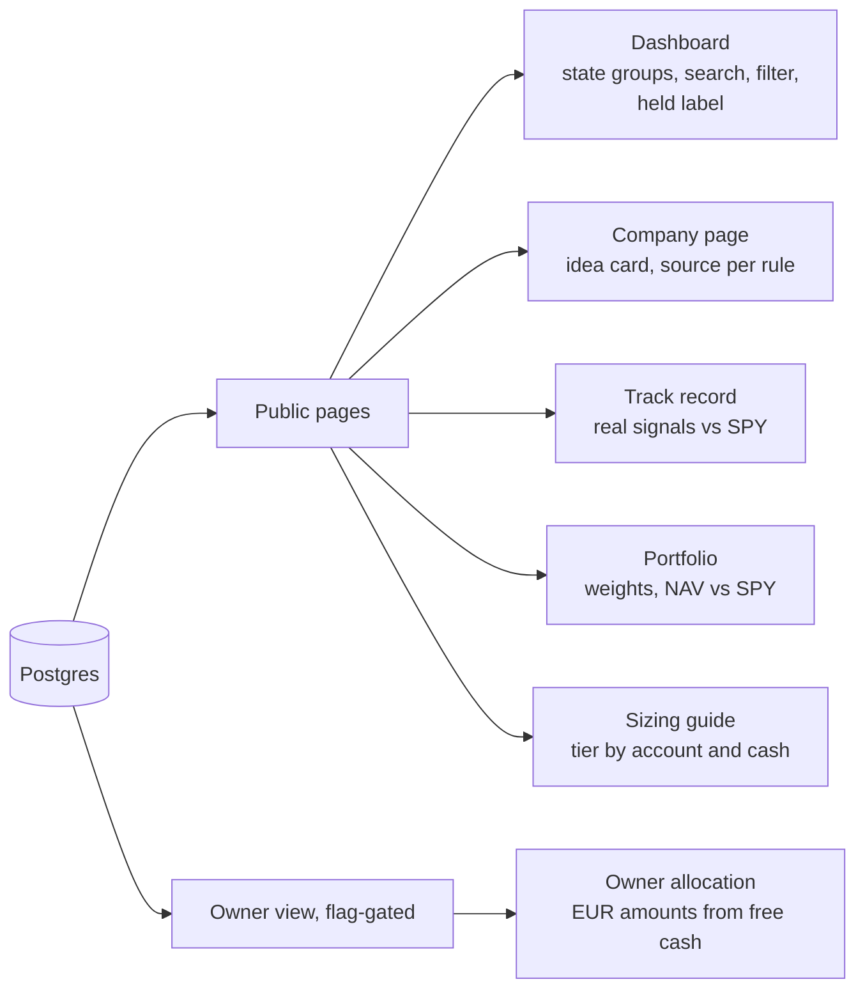

# Architecture diagrams

Mermaid diagrams, rendered by GitHub. Keep them in step with `deploy/README.md` and `docs/script-first-pipeline.md`. Schedules are Europe/Bratislava unless noted. The state of each job (running or suspended) is in `docs/SESSION-HANDOFF.md`.

## 1. Data pipeline

Scripts do the work. The two AI steps (extract, judge) run only when the change gate says something changed, and stay inside the monthly token cap.

## 2. From claim to score

## 3. How a change reaches the cluster

The pin is the last build to finish. When several PRs merge in a row, check that the pin equals the `main` short sha.

## 4. Runtime on khtz

## 5. What each public and private view shows

Public pages carry no EUR amounts (ADR-001). EUR amounts exist only in the owner view.
